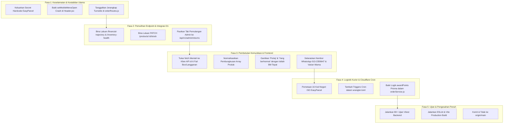

# LAPORAN AUDIT SISTEM & PELAN PEMBAIKAN LENGKAP (DIN'O EMPIRE)
*Tarikh Audit: 23 Oktober 2026 | Versi Dokumen: 2.0 (Forensik Penuh)*
*Penyedia: Pembantu Pembangunan DIN'O EMPIRE*

---

## 1. RINGKASAN EKSEKUTIF

Audit forensik mendalam telah dilaksanakan merangkumi keseluruhan pangkalan kod DIN'O EMPIRE:
- **Frontend**: 81 fail (React 19, Vite, Tailwind CSS, Lucide Icons)
- **Backend API**: 101 fail (Cloudflare Workers, Hono, Prisma ORM Edge, D1 SQLite)
- **Storan & Aset**: Cloudflare R2 Bucket (`dino-empire-assets`) & CDN (`cdn.dinoempire.my`)
- **Gerbang Pembayaran**: ToyyibPay FPX & Kad Debit/Kredit
- **Sistem Logistik**: EasyParcel Malaysia Open API
- **Pengesahan & Keselamatan**: Cloudflare Access & Sistem Sesi PIN Pentadbir

Hasil audit mendapati **14 titik kegagalan sistem, percanggahan komunikasi, dan ralat kritikal** yang sedang menjejaskan operasi kedai dalam persekitaran pengeluaran (*production*).

---

## 2. JADUAL INDEKS 14 MASALAH UTAMA SISTEM

| No | Modul / Komponen | Tahap Bahaya | Masalah Ditemui | Status & Kesan Operasi |
|---|---|---|---|---|
| **1** | `easyParcelService.js`, `easyParcelCallback.js` | 🚨 **KRITIKAL** | Kebocoran Secret Key Hardcoded | Secret key EasyParcel (`06311766-...`) terdedah dalam kod sumber (Melanggar Rule 2 `GEMINI.md`). |
| **2** | `adminAuth.js`, `adminRoutes.js` | 🚨 **KRITIKAL** | Sesi PIN Pentadbir Sekat 503 | `ADMIN_SESSION_SECRET` (min 32 aksara) belum diset di Cloudflare Workers. Log masuk PIN disekat dengan 503 Service Unavailable. PIN asal D1 ialah `dino1234`. |
| **3** | `Header.jsx` | 💥 **FATAL** | Ralat Fatal Butang Carian (Crash) | Menekan butang *Enter* pada kotak carian memanggil fungsi `setMobileMenuOpen(false)` yang tidak wujud $\rightarrow$ Skrin putih (*Crash*). |
| **4** | `BoxBuilderPage`, `MySubscriptionsPage`, dll. | 🔴 **TINGGI** | Panggilan API Mentah Hilang Domain (404) | 6 fail frontend menggunakan `fetch()` mentah tanpa baseURL API. Permintaan dihantar ke pelayan statik `dinoempire.my` (bukan `api.dinoempire.my`) lalu memulangkan 404. |
| **5** | `orderService.js` (Mata Ganjaran) | 🔴 **TINGGI** | Kegagalan Pemberian Mata Ganjaran | Terbukti dalam ujian Vitest: `awardPoints` gagal kerana proksi Prisma belum diikat semasa webhook bayaran diterima (*"Prisma client has not been initialized with env yet!"*). |
| **6** | `adminRoutes.js` (Endpoint Ghaib) | 🔴 **TINGGI** | 3 Endpoint Admin Tidak Wujud di Backend | Laluan `/financial-trajectory`, `/inventory-health`, dan `/products/:id/stock` dipanggil oleh panel admin tetapi tiada dalam kod pelayan. |
| **7** | `TikTokBioPage`, `TikTokReelsSection`, `CmsManagerTab` | 🔴 **TINGGI** | Data Produk Hilang Senyap (*Silent Loss*) | Komponen frontend menjangka respons dibungkus dalam `{ data: [...] }` sedangkan backend memulangkan `Array` terus. Katalog produk kosong. |
| **8** | `AdminDashboardPage.jsx` (Pemulangan) | 🟡 **SEDERHANA** | Tab Pemulangan (Returns) Adalah Dummy | Tab tuntutan pemulangan & *refund* hanya memaparkan kad teks statik palsu. Ia tidak memanggil API sebenar `/api/v1/admin/returns`. |
| **9** | `adminRoutes.js` (EasyParcel State) | 🔴 **TINGGI** | Negeri Penerima Hardcode Kedah (`MY-02`) | Semua tempahan EasyParcel dihantar dengan kod negeri `MY-02` (Kedah) walaupun pelanggan tinggal di Selangor, Johor, Sabah, atau Sarawak. |
| **10** | `Footer.jsx`, `SEO.jsx`, `Shop.jsx`, `emailService.js` | 🟡 **SEDERHANA** | Penggunaan Perkataan Pelik & Janggal | Perkataan aneh **"Portaj"** digunakan (sepatutnya *Penghantaran*), gelaran **"Yang berhormat"** untuk pembeli runcit, dan status mentah Turki (*BEKLEMEDE*). |
| **11** | `CartContext.jsx` vs Komponen | 🟡 **SEDERHANA** | Percanggahan Nama Varian Warna | Komponen menghantar `secilenRenk: 'Standard'`, tetapi `CartContext` hanya membaca `selectedColor`, menyebabkan varian hilang dalam troli dan checkout. |
| **12** | `api/wrangler.toml` (Cron Triggers) | 🔴 **TINGGI** | Cloudflare Cron Tidak Dikonfigurasi | Tiada blok `[triggers] crons`, menyebabkan fungsi harian pembaharuan langganan dan *sitemap warmup* tidak pernah dicetuskan oleh Cloudflare. |
| **13** | `orderRoutes.js` (Turnstile) | ⚠️ **POTENSI** | Jerangkap Turnstile 403 pada Checkout | Laluan checkout dipasang `turnstileGuard('checkout')` tetapi frontend tiada komponen Captcha. Jika secret diaktifkan, 100% bayaran pelanggan disekat. |
| **14** | `TikTokBioPage.jsx` vs `CheckoutPage.jsx` | 🟡 **SEDERHANA** | Kod Kupon TikTok Tiada Medan Input | Halaman Bio TikTok mempromosikan kod kupon diskaun (cth. `TIKTOK10`), tetapi halaman Checkout dan Backend tiada medan mahupun logik pengesahan kupon. |

---

## 3. BEDAH SIASAT TERPERINCI SETIAP MASALAH

### 🚨 1. Kebocoran Kredensial Hardcoded (EasyParcel Secret)
- **Fail:** [api/src/services/easyParcelService.js](file:///c:/Users/pi1mc/.gemini/antigravity/scratch/sansetv1bhjjbh/api/src/services/easyParcelService.js#L23) dan [api/src/routes/easyParcelCallback.js](file:///c:/Users/pi1mc/.gemini/antigravity/scratch/sansetv1bhjjbh/api/src/routes/easyParcelCallback.js#L14)
- **Kod Bermasalah:**
  ```javascript
  this.clientSecret = env.EASYPARCEL_CLIENT_SECRET || '06311766-68d5-4b1b-8264-7cd5a8462333';
  ```
- **Kesan:** Kunci rahsia EasyParcel terdedah secara langsung dalam repositori git.
- **Penyelesaian:** Buang nilai sandaran teks biasa. Gunakan `env.EASYPARCEL_CLIENT_SECRET || ''` dan pastikan secret dimasukkan melalui Cloudflare Workers secret (`npx wrangler secret put EASYPARCEL_CLIENT_SECRET`).

---

### 🔐 2. Sesi PIN Pentadbir Menghasilkan 503 Service Unavailable
- **Fail:** [api/src/middlewares/adminAuth.js](file:///c:/Users/pi1mc/.gemini/antigravity/scratch/sansetv1bhjjbh/api/src/middlewares/adminAuth.js#L106-L115) dan [api/src/utils/adminSession.js](file:///c:/Users/pi1mc/.gemini/antigravity/scratch/sansetv1bhjjbh/api/src/utils/adminSession.js#L36-L45)
- **Punca:**
  Sistem log masuk PIN menggunakan enkripsi Web Crypto HMAC-SHA256 yang mewajibkan `ADMIN_SESSION_SECRET` dengan kepanjangan minimum 32 aksara. Jika secret ini belum disetkan di Workers, laluan log masuk terus ditolak:
  ```javascript
  if (!isSessionConfigured(c.env)) return c.json({ status: 'error', errorMessage: NOT_CONFIGURED }, 503);
  ```
- **PIN Lalai (Default):**
  Dalam pangkalan data D1 (skrip migrasi `0010_settings_branding_auth.sql`), ruangan `adminPin` lalai ialah `'dino1234'`.
- **Penyelesaian:**
  1. Pastikan arahan manual disediakan untuk menetapkan secret:
     ```bash
     cd api && npx wrangler secret put ADMIN_SESSION_SECRET
     ```
  2. Kemas kini mesej ralat agar pentadbir memahami keperluan memasukkan secret tersebut.

---

### 💥 3. Fatal React Crash pada Kotak Carian Header
- **Fail:** [client/src/components/Header.jsx](file:///c:/Users/pi1mc/.gemini/antigravity/scratch/sansetv1bhjjbh/client/src/components/Header.jsx#L21)
- **Kod Bermasalah:**
  ```javascript
  const handleSearch = (e) => {
      e.preventDefault();
      if (searchQuery.trim()) {
          navigate(`/kedai?search=${encodeURIComponent(searchQuery.trim())}`);
          setShowSearch(false);
          setMobileMenuOpen(false); // <--- ReferenceError: setMobileMenuOpen is not defined
      }
  };
  ```
- **Kesan:** Apabila pelanggan menaip barangan dalam carian dan menekan *Enter*, seluruh aplikasi React mengalami *crash* skrin putih.
- **Penyelesaian:** Padamkan baris `setMobileMenuOpen(false)`.

---

### 🌐 4. Panggilan API Mentah Hilang Domain API di Production (404)
- **Fail Terlibat:**
  1. [client/src/pages/BoxBuilderPage.jsx](file:///c:/Users/pi1mc/.gemini/antigravity/scratch/sansetv1bhjjbh/client/src/pages/BoxBuilderPage.jsx#L93)
  2. [client/src/pages/MySubscriptionsPage.jsx](file:///c:/Users/pi1mc/.gemini/antigravity/scratch/sansetv1bhjjbh/client/src/pages/MySubscriptionsPage.jsx#L29-L55)
  3. [client/src/components/PointsRedeem.jsx](file:///c:/Users/pi1mc/.gemini/antigravity/scratch/sansetv1bhjjbh/client/src/components/PointsRedeem.jsx#L13)
  4. [client/src/pages/EnterpriseHomePage.jsx](file:///c:/Users/pi1mc/.gemini/antigravity/scratch/sansetv1bhjjbh/client/src/pages/EnterpriseHomePage.jsx#L49)
  5. [client/src/components/enterprise/LiveTelemetryBadge.jsx](file:///c:/Users/pi1mc/.gemini/antigravity/scratch/sansetv1bhjjbh/client/src/components/enterprise/LiveTelemetryBadge.jsx#L15)
  6. [client/src/components/enterprise/WarRoomDrawer.jsx](file:///c:/Users/pi1mc/.gemini/antigravity/scratch/sansetv1bhjjbh/client/src/components/enterprise/WarRoomDrawer.jsx#L19)
- **Punca:**
  Menggunakan `const API = import.meta.env.VITE_API_URL || '';` diikuti `fetch(`${API}/api/v1/...`)`. Di Cloudflare Pages (`dinoempire.my`), `VITE_API_URL` tidak diset secara lalai. Panggilan dihantar ke `https://dinoempire.my/api/v1/...` (pelayan frontend statik) bukannya ke Workers `https://api.dinoempire.my/api/v1/...`, menyebabkan ralat 404.
- **Penyelesaian:** Gantikan semua `fetch` mentah dengan klien axios `api` dari `src/lib/axios.js` yang mempunyai konfigurasi URL fallback automatik.

---

### 📉 5. Kegagalan Pemberian Mata Ganjaran (Loyalty Points)
- **Fail:** [api/src/services/orderService.js](file:///c:/Users/pi1mc/.gemini/antigravity/scratch/sansetv1bhjjbh/api/src/services/orderService.js#L25-L60)
- **Bukti Ralat (Vitest stderr):**
  ```
  [Points] Failed to award points: Prisma client has not been initialized with env yet! Run getPrisma(env) in middleware.
  ```
- **Punca:** `awardPoints` dan `deductPoints` adalah fungsi modul yang memanggil objek proksi global `prisma` sebelum ia diikat dengan Cloudflare Worker `env.DB`.
- **Penyelesaian:** Pautkan klien database melalui `this.orderRepository.prisma` atau luluskan instans pangkalan data yang sah ke dalam fungsi pemberian mata ganjaran.

---

### 🚫 6. Tiga (3) Endpoint Pentadbir Tiada dalam Backend API
- **Fail Panggilan Frontend:**
  - [AdminDashboardPage.jsx](file:///c:/Users/pi1mc/.gemini/antigravity/scratch/sansetv1bhjjbh/client/src/pages/admin/AdminDashboardPage.jsx#L220-L222)
  - [InventoryHealthTab.jsx](file:///c:/Users/pi1mc/.gemini/antigravity/scratch/sansetv1bhjjbh/client/src/components/admin/InventoryHealthTab.jsx#L29)
- **Laluan Ghaib:**
  1. `GET /api/v1/admin/financial-trajectory`
  2. `GET /api/v1/admin/inventory-health`
  3. `PATCH /api/v1/admin/products/:id/stock`
- **Kesan:** Tab Unjuran Kewangan dan Kesihatan Inventori di admin sentiasa kosong. Menekan butang tambah/tolak stok pantas menghasilkan ralat 404 pelayan.
- **Penyelesaian:** Daftarkan ketiga-tiga laluan ini dalam [api/src/routes/adminRoutes.js](file:///c:/Users/pi1mc/.gemini/antigravity/scratch/sansetv1bhjjbh/api/src/routes/adminRoutes.js) dengan menyambungkannya ke pangkalan data D1.

---

### 📦 7. Pembungkusan Tatasusunan Produk (Data Array Unpacking Mismatch)
- **Fail Terlibat:**
  - [client/src/pages/TikTokBioPage.jsx](file:///c:/Users/pi1mc/.gemini/antigravity/scratch/sansetv1bhjjbh/client/src/pages/TikTokBioPage.jsx#L78)
  - [client/src/components/home/TikTokReelsSection.jsx](file:///c:/Users/pi1mc/.gemini/antigravity/scratch/sansetv1bhjjbh/client/src/components/home/TikTokReelsSection.jsx#L31)
  - [client/src/components/admin/CmsManagerTab.jsx](file:///c:/Users/pi1mc/.gemini/antigravity/scratch/sansetv1bhjjbh/client/src/components/admin/CmsManagerTab.jsx#L97)
- **Kod Bermasalah:**
  ```javascript
  const prods = prodRes.data?.data || prodRes.data?.urunler || [];
  ```
- **Punca:** Backend memulangkan `Array` secara terus pada `prodRes.data`. Kod di atas menghasilkan `prods = []` (kosong).
- **Penyelesaian:** Normalisasikan kepada:
  ```javascript
  const prods = Array.isArray(prodRes.data) ? prodRes.data : (prodRes.data?.data || prodRes.data?.urunler || []);
  ```

---

### 🛑 8. Tab Pengurusan Pemulangan (Returns) Pentadbir Hanyalah Dummy
- **Fail:** [client/src/pages/admin/AdminDashboardPage.jsx](file:///c:/Users/pi1mc/.gemini/antigravity/scratch/sansetv1bhjjbh/client/src/pages/admin/AdminDashboardPage.jsx#L2036-L2049)
- **Punca:**
  Pelanggan boleh menghantar permohonan pemulangan melalui `OrderTrackingPage.jsx` (`POST /api/v1/returns/request`). Laluan backend `GET /api/v1/admin/returns` dan `PUT /api/v1/admin/returns/:id` sudah siap wujud. Namun pada panel pentadbir, tab pemulangan hanya mengandungi kad statik: *"Tiada Permohonan Pemulangan Tertunggak"*. Pentadbir langsung tidak dapat melihat atau meluluskan permohonan bayaran balik.
- **Penyelesaian:** Pautkan tab pemulangan kepada API `/api/v1/admin/returns` dan sediakan butang kelulusan/penolakan untuk pentadbir.

---

### 🚚 9. Penghantaran EasyParcel Hardcode Negeri Kedah (`MY-02`)
- **Fail:** [api/src/routes/adminRoutes.js](file:///c:/Users/pi1mc/.gemini/antigravity/scratch/sansetv1bhjjbh/api/src/routes/adminRoutes.js#L379-L401)
- **Kod Bermasalah:**
  ```javascript
  receiverState: 'MY-02',
  subdivision_code: 'MY-02',
  ```
- **Kesan:** Bungkusan pelanggan di luar Kedah (cth. Johor, Selangor, Sabah, Sarawak) didaftarkan sebagai Kedah dalam sistem kurier EasyParcel.
- **Penyelesaian:** Wujudkan pemetaan automatik nama negeri pembeli ke kod ISO piawai Malaysia (`MY-01` hingga `MY-16`).

---

### 🗣️ 10. Komunikasi Pelik, Janggal & Tidak Relevan
1. **Perkataan Pelik "Portaj"**:
   - Dijumpai di: [Footer.jsx](file:///c:/Users/pi1mc/.gemini/antigravity/scratch/sansetv1bhjjbh/client/src/components/Footer.jsx#L72), [SEO.jsx](file:///c:/Users/pi1mc/.gemini/antigravity/scratch/sansetv1bhjjbh/client/src/components/SEO.jsx#L33), [Shop.jsx](file:///c:/Users/pi1mc/.gemini/antigravity/scratch/sansetv1bhjjbh/client/src/pages/Shop.jsx#L31), [TikTokVideoShowcase.jsx](file:///c:/Users/pi1mc/.gemini/antigravity/scratch/sansetv1bhjjbh/client/src/components/enterprise/TikTokVideoShowcase.jsx#L45).
   - Teks: *"Portaj pantas dan kualiti dijamin Halal"*, *"Portaj terus ke depan pintu anda"*.
   - Pembetulan: Tukar kepada **"Penghantaran pantas"** atau **"Pengeposan pantas"**.
2. **Gelaran "Yang berhormat" untuk Pelanggan**:
   - Dijumpai di: [api/src/services/emailService.js](file:///c:/Users/pi1mc/.gemini/antigravity/scratch/sansetv1bhjjbh/api/src/services/emailService.js#L163-L202).
   - Teks: `<p>Yang berhormat <strong>${esc(toName)}</strong>,</p>`.
   - Pembetulan: Gantikan dengan **"Pelanggan yang dihormati"** atau **"Salam sejahtera"**.
3. **Status Mentah Turki dalam E-mel Notifikasi Penjual**:
   - Dijumpai di: [api/src/services/emailService.js](file:///c:/Users/pi1mc/.gemini/antigravity/scratch/sansetv1bhjjbh/api/src/services/emailService.js#L262-L263).
   - Teks: `Status: BEKLEMEDE` / `HAZIRLANIYOR`.
   - Pembetulan: Petakan nilai pangkalan data ke Bahasa Melayu kemas (*"Menunggu Pembayaran"*, *"Sedang Disediakan"*, *"Dihantar"*).
4. **Percanggahan Nombor Telefon WhatsApp**:
   - Talian WhatsApp rasmi ialah `013-2359647` (`60132359647`). Di `OrderTrackingPage.jsx:101`, `PaymentFailurePage.jsx:59`, dan `FAQPage.jsx:48`, pautan `wa.me` diletakkan ke nombor telefon panggilan suara `016-6911020`.
   - Pembetulan: Selaraskan semua pautan WhatsApp kepada `013-2359647`.

---

### 🎨 11. Percanggahan Nama Varian Warna (`secilenRenk` vs `selectedColor`)
- **Fail:** [client/src/context/CartContext.jsx](file:///c:/Users/pi1mc/.gemini/antigravity/scratch/sansetv1bhjjbh/client/src/context/CartContext.jsx#L39) dan pelbagai komponen produk.
- **Punca:** Komponen produk menghantar `{ secilenRenk: 'Standard' }`, tetapi `CartContext` hanya membaca `product.selectedColor`. Ini menyebabkan pilihan varian warna/saiz menjadi `null` dan hilang semasa checkout.
- **Penyelesaian:** Selaras pembacaan varian dalam `CartContext`:
  ```javascript
  const selectedColor = product.selectedColor || product.secilenRenk || null;
  ```

---

### ⏰ 12. Konfigurasi Cloudflare Cron Triggers Tidak Wujud
- **Fail:** [api/wrangler.toml](file:///c:/Users/pi1mc/.gemini/antigravity/scratch/sansetv1bhjjbh/api/wrangler.toml)
- **Punca:** `src/app.js` mempunyai fungsi `scheduled(event, env, ctx)` untuk memperbaharui langganan harian dan memanaskan sitemap cache. Namun `wrangler.toml` tiada deklarasi `[triggers] crons`.
- **Penyelesaian:** Tambah blok konfigurasi:
  ```toml
  [triggers]
  crons = [ "0 0 * * *" ]
  ```

---

### ⚠️ 13. Jerangkap Turnstile 403 pada Laluan Checkout
- **Fail:** [api/src/routes/orderRoutes.js](file:///c:/Users/pi1mc/.gemini/antigravity/scratch/sansetv1bhjjbh/api/src/routes/orderRoutes.js#L12)
- **Punca:** Laluan `POST /api/v1/orders/checkout` dipasang middleware `turnstileGuard('checkout')`. Frontend `CheckoutPage.jsx` tiada widget Captcha Turnstile. Jika pengguna memasukkan `TURNSTILE_SECRET` ke dalam Workers, setiap transaksi pembayaran disekat serta-merta dengan ralat 403.
- **Penyelesaian:** Tanggalkan `turnstileGuard` daripada laluan checkout (pesanan sudah dilindungi oleh pengesahan skema Zod, pengehad kadar *rate limit*, dan pengesahan ToyyibPay).

---

### 🎟️ 14. Baucar Diskaun TikTok Tiada Medan Input Semasa Checkout
- **Fail:** [client/src/pages/TikTokBioPage.jsx](file:///c:/Users/pi1mc/.gemini/antigravity/scratch/sansetv1bhjjbh/client/src/pages/TikTokBioPage.jsx#L101) dan [client/src/pages/CheckoutPage.jsx](file:///c:/Users/pi1mc/.gemini/antigravity/scratch/sansetv1bhjjbh/client/src/pages/CheckoutPage.jsx)
- **Punca:** Pengguna TikTok disajikan dengan butang salin kupon diskaun (cth: `TIKTOK10`), tetapi apabila tiba di halaman checkout, tiada sebarang medan input kod kupon atau logik potongan harga disediakan.
- **Penyelesaian:** Sediakan medan input kod baucar di halaman checkout yang memvalidasi kod promosi atau selaraskan mesej promosi dengan diskaun bertingkat sedia ada.

---

## 4. PELAN TINDAKAN PEMBAIKAN MENYELURUH



---
*Dokumen ini dijana untuk tujuan semakan silang pentadbir dan agen AI.*
